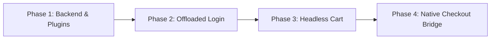

# Headless Next.js + WooCommerce Implementation Plan

Roadmap to go from the initial environment to a fully operational headless e-commerce store with offloaded WordPress authentication, unified-domain session sharing, headless shopping cart, and seamless native checkout.

---

---

## Phase 1: WordPress Backend & Plugin Foundations

- [x] **1.1. Install WPGraphQL & WooGraphQL Extension (`wp-graphql-woocommerce`)**
  - Expose WooCommerce types (`Product`, `Cart`, `Customer`, `Order`) and mutations (`addToCart`, `checkout`) to GraphQL.
- [x] **1.2. Deploy Headless Redirect Must-Use Plugin**
  - Implemented `prod/WordPress/WordPress/wp-content/mu-plugins/headless-redirects.php` to hook `woocommerce_login_redirect`, `woocommerce_registration_redirect`, and `wp_logout` so WordPress redirects customers back to Next.js (`/account` or `?redirect_to=...`), while preserving `/wp-admin` access for administrators.
- [x] **1.3. Seed Catalog Dummy Products**
  - Imported sample products dataset (`sample_products.csv`) with prices, simple/variable products, and categories.
- [x] **1.4. Configure Test Payment Gateway & Shipping Zone**
  - Configured store currency to Iranian Toman (`IRT`), enabled ZarinPal Sandbox gateway, and set shipping rules.

---

## Phase 2: Working Customer Login Flow (Offloaded to WordPress)

- [x] **2.1. Configure `/login` Route in Next.js**
  - Updated `app/login/page.tsx` to redirect unauthenticated visitors to `/my-account?redirect_to=/account` (or referring URL).
  - Traefik intercepts `/my-account` (priority 100) and serves native WooCommerce customer login/register form.
  - Authenticated visitors with `wordpress_logged_in_*` cookies bypass the login form and redirect straight to the destination.
- [x] **2.2. Implement Customer Dashboard (`app/account/page.tsx`)**
  - Created `app/account/page.tsx` as a React Server Component.
  - Forwards browser cookies (`wordpress_logged_in_*`, `auth_token`) to `https://shop.local/graphql`.
  - Queries `GET_USER_PROFILE_QUERY` to retrieve customer profile, billing address, and orders.
  - Redirects unauthenticated sessions to `/login?redirect_to=/account`.
  - Fixed WordPress mu-plugin (`headless-redirects.php`) to intercept `/my-account/` via `template_redirect` and safely redirect logged-in visitors to `/account`.
- [x] **2.3. Update Navbar / Header Auth Indicator**
  - Updated `app/page.tsx` to read `wordpress_logged_in_*` and `auth_token` cookies.
  - Dynamically renders "My Account" (`/account`) when logged in and "Account / Sign In" (`/login`) when unauthenticated.
- [ ] **2.4. Verify Authentication Loop**
  - Test: Visit `/account` $\rightarrow$ redirect to `/my-account` $\rightarrow$ login $\rightarrow$ redirect to Next.js `/account` $\rightarrow$ customer dashboard renders.

---

## Phase 3: Working Shopping Cart Flow (Next.js Headless Cart)

- [ ] **3.1. Update Universal Client to Forward Cookies**
  - Update `lib/woocommerce/client.ts` (`fetchWooCommerce`) to forward `Cookie: cookieStore.toString()` and `Host: shop.local` so every GraphQL request shares the browser's exact WordPress and WooCommerce session.
- [ ] **3.2. Implement `addToCart` Server Action**
  - Update `app/cart/actions.ts` to call WooGraphQL `addToCart` mutation using active cookies and capture any returned session headers.
- [ ] **3.3. Verify Headless Cart Page (`app/cart/page.tsx`)**
  - Verify `app/cart/CartView.tsx` displays line items, quantities, subtotal, and total directly from `query { cart { contents { nodes { key quantity product { node { name price } } } } total } }`.
  - Confirm cart items persist across page refreshes.

---

## Phase 4: Seamless Native Checkout Page (The Bridge)

- [ ] **4.1. Configure "Proceed to Checkout" Button in Cart**
  - In `app/cart/CartView.tsx`, update checkout trigger to navigate directly to `/checkout`.
- [ ] **4.2. Verify Traefik Checkout Routing**
  - Traefik routes `/checkout` (priority 100) to WordPress.
  - Verify customer is already logged in (via `wordpress_logged_in_*`), cart items are already present (via `wp_woocommerce_session_*`), and shipping/gateways calculate dynamically.
- [ ] **4.3. End-to-End Order Placement Test**
  - Complete checkout with ZarinPal Sandbox $\rightarrow$ verify redirect to WooCommerce "Order Received" receipt page $\rightarrow$ return to `/account` in Next.js and confirm order appears in recent orders.
